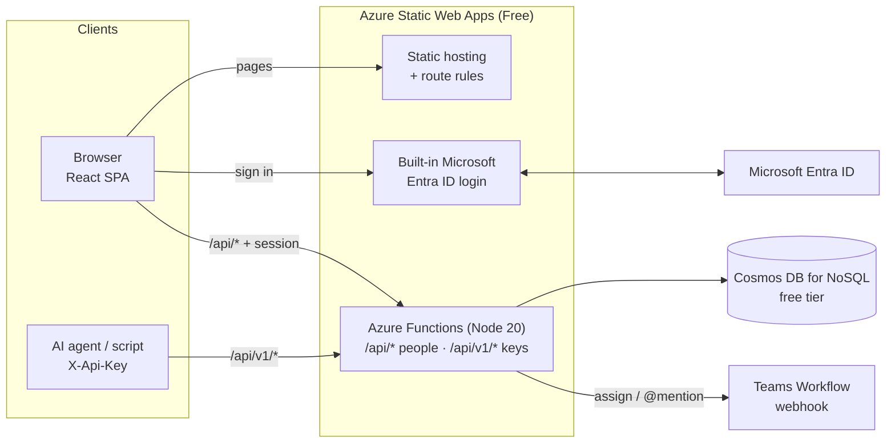
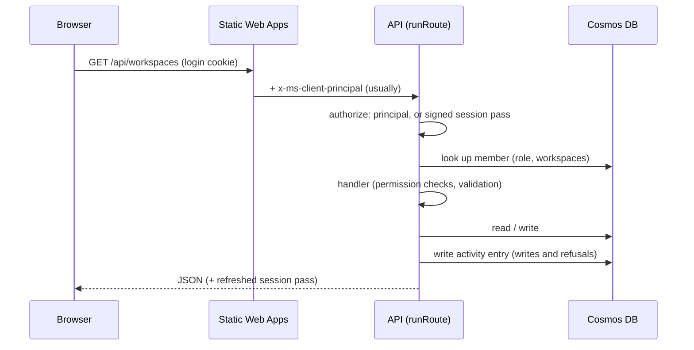
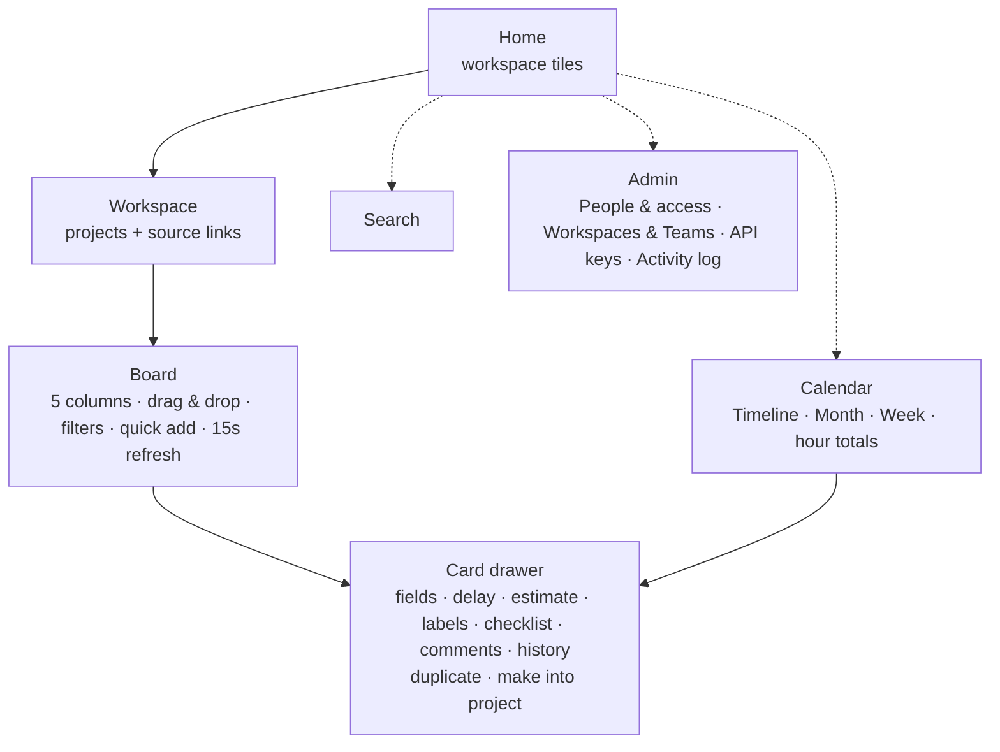

# Architecture

## System

- **Front end:** a React 18 single-page app built with Vite and Tailwind, with drag and drop from `@dnd-kit`. Static Web Apps serves it, and every page requires sign-in (`staticwebapp.config.json`).
- **API:** Azure Functions managed by the Static Web App. One route table (`api/shared/routes.mjs`) is registered twice, as two doors:
  - **`/api/*` for signed-in people.** A request with an API key here gets `401 use_api_v1`.
  - **`/api/v1/*` for API keys only.** A request without a key here gets `401 api_key_required`.
- **Database:** Cosmos DB for NoSQL on the free tier. One database with shared throughput (created at 400 RU/s), and containers are created on first use. Locally, `memoryStore.mjs` implements the same interface on a JSON file.

## A request, step by step

`runRoute` is the only path into a handler:
1. Seed the workspaces on first start.
2. Work out who's calling (`authorize`).
3. Require JSON for writes.
4. Run the handler.
5. Write the activity entry that the handler returned.
6. Turn errors into `{ ok: false, error, message }`.

### Why there's a session pass

Static Web Apps is meant to attach the signed-in user (`x-ms-client-principal`) to every API call. In production it sometimes doesn't, so a signed-in person would intermittently look anonymous. To cover for that, whenever a request *does* carry a real principal, the API gives the browser a short-lived pass (`api/shared/session.mjs`):
- It holds the email and an expiry, signed with HMAC-SHA256 using `KANBAN_SESSION_SECRET`.
- It's an `HttpOnly; Secure; SameSite=Strict; Path=/api` cookie, valid for 8 hours and refreshed after 15 minutes.

Membership and role are still checked on every request, so removing a person locks them out immediately. `/logout` clears the pass, then signs out of Microsoft.

## Access model

| Who | Sees | Can change |
|---|---|---|
| Admin | Every workspace | Everything, including people, keys, workspaces and projects |
| Member | Workspaces ticked for them | Cards, comments and projects in those workspaces (not deleting projects) |
| Viewer | Workspaces ticked for them | Nothing |
| Key: Read-only | Its workspaces (or all) | Nothing |
| Key: Cards & comments | Its workspaces (or all) | Cards and comments (duplicate too). Not projects |
| Key: Admin | All workspaces | Workspaces and projects. Never people or keys. |

- **Edit domains:** with `KANBAN_EDIT_DOMAINS` set, anyone outside those domains is a viewer, whatever their record says.
- **Bootstrap admins:** emails in `KANBAN_ADMIN_EMAILS` are always admins.
- **Keys:** stored only as SHA-256 hashes. The plain key is shown once. Keys can expire after 30, 90 or 365 days, or never.
- **Webhook URLs:** Teams webhook URLs are credentials, so only admins see them and the activity log records only "set" or "none".
- **CSRF:** writes require `Content-Type: application/json`, and the pass is `SameSite=Strict`.

## Data model

| Container | Partition key | Holds |
|---|---|---|
| `workspaces` | `/id` | name, task-number prefix, Teams webhook URL |
| `members` | `/id` (lower-case email) | name, role, workspaceIds |
| `projects` | `/workspaceId` | name, description, repo URL, dueDate or ongoing, labelIds, parentCardId, archived |
| `cards` | `/projectId` | number, title, description, column, order, assigneeEmails, startDate, dueDate, estimateHours, delayed + delayReason, labelIds, checklist, childProjectId, comment count, created/updated stamps |
| `comments` | `/cardId` | body, mentions, author |
| `apiKeys` | `/id` | name, scope, workspaceIds, expiresAt, sha256Hash, lastUsedAt, revoked |
| `activity` | `/workspaceId` (`global` for people and keys) | who, action, summary, old → new changes, route |
| `labels` | `/id` | name, colour. Shared by every workspace |
| `counters` | `/id` | `task-<workspaceId>` → the last task number handed out |

- **Card order:** a number. A dropped card gets the midpoint between its new neighbours, so a move writes one document.
- **Task numbers:** they come from an atomic counter (a Cosmos partial-update `incr`), so tasks created in parallel never share a number.
- **Planned hours:** `estimateHours × KANBAN_ESTIMATE_BUFFER` (1.3 by default), computed on read and never stored.
- **Older records:** a one-time, idempotent migration at startup gives cards without a number one, and turns the old single `assigneeEmail` into `assigneeEmails`.

## UI

Viewers get the same screens with every edit control removed. The API refuses their writes anyway.

## Tools

| Layer | Tools |
|---|---|
| UI | React 18, Vite, Tailwind CSS, react-router, @dnd-kit, lucide-react |
| API | Azure Functions v4 (Node 20), @azure/cosmos |
| Hosting | Azure Static Web Apps (Free), Cosmos DB free tier |
| Tooling | Azure CLI, SWA CLI, GitHub Actions (tests, typecheck, lint, build) |

## Cost

- **Static Web Apps Free:** $0.
- **Cosmos DB free tier:** the first 1000 RU/s and 25 GB are free for the life of the account, and each subscription gets one such account.
- **Typical use:** opening a board costs about 20 RU, and a card move about 15 RU. At 400 RU/s, a team of 10–20 people uses a few percent of the free capacity.
